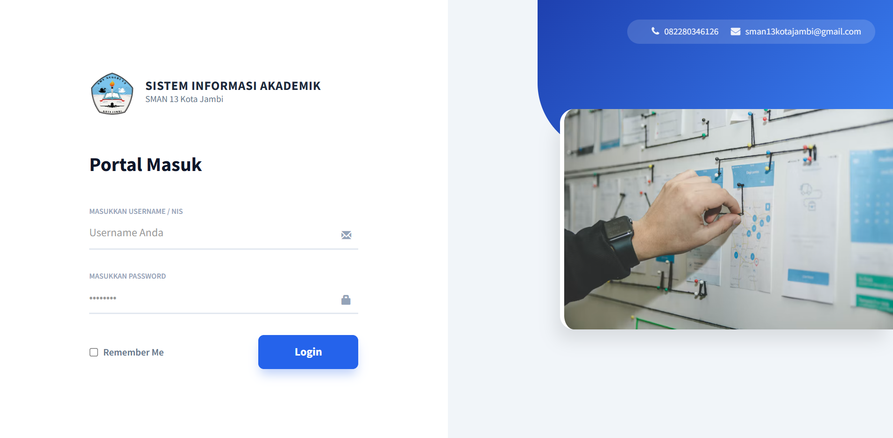
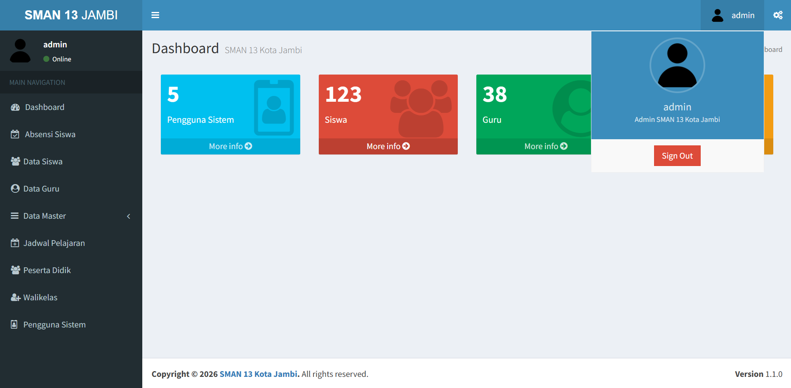
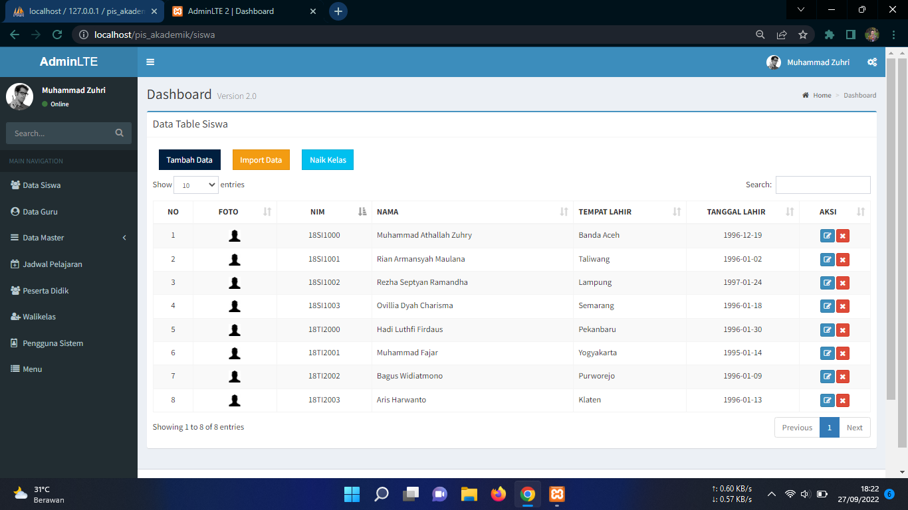
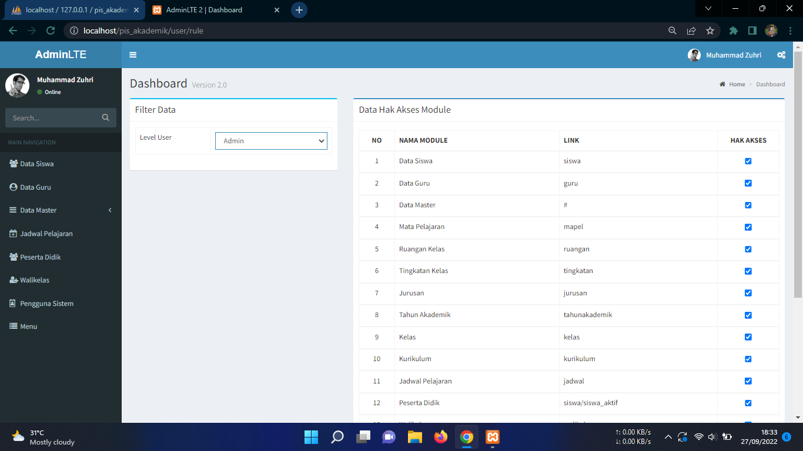

# Aplikasi Akademik Sekolah Berbasis Web

To access admin page. Example http://si-sman13.xo.je/

## Tampilan Aplikasi

Feature
----------
- 4 Login Level (dynamic || can be added by yourself)
- Login With Session
- CRUD Siswa(Students)
- Import Data Siswa(Students) via Csv
- CRUD Guru
- CRUD Mapel
- CRUD Ruangan Kelas
- CRUD Tingkatan Kelas
- CRUD Jurusan
- CRUD Tahun Akademik
- CRUD Kelas
- CRUD Kurikulum
- View Detail Kurikulum
- Edit Walikelas
- CRUD Menu
- CRUD User(Super Admin/Admin/Keuangan)
- Manage Rule User
- Generate Jadwal Pelajaran(Not Genetic Algorithm)
- Print Jadwal Pelajaran
- Export Data Siswa
- Input Nilai Siswa
- Export Data Nilai (e-Raport)

Requitment
----------
- PHP 5
